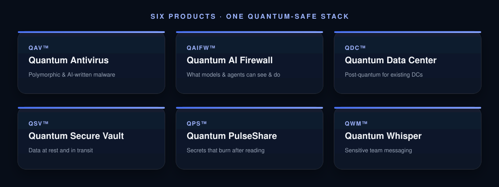
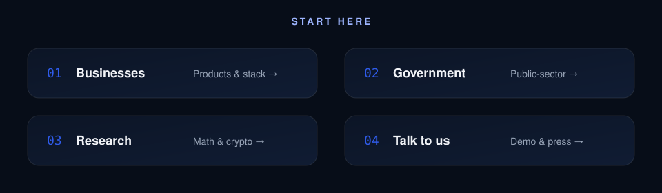

<!--
  Org profile → https://github.com/Qvanta-BigDx-Group
  Visual language aligned with https://qvanta.io
-->

  

# Qvanta®

### Private engineering home for BigΔx™

Quantum-safe security software for businesses, government agencies, and research teams.

 

&nbsp;

&nbsp;

 

 

  <a href="https://qvanta.io/Product.dc.html?p=QAV">QAV™</a> ·
  <a href="https://qvanta.io/Product.dc.html?p=QAIFW">QAIFW™</a> ·
  <a href="https://qvanta.io/Product.dc.html?p=QDC">QDC™</a> ·
  <a href="https://qvanta.io/Product.dc.html?p=QSV">QSV™</a> ·
  <a href="https://qvanta.io/Product.dc.html?p=QPS">QPS™</a> ·
  <a href="https://qvanta.io/Product.dc.html?p=QWM">QWM™</a>

No rip-and-replace. BigΔx runs next to what you already ship.

 

 

### Where do you want to start?

 

 

[Website](https://qvanta.io) · [Government](https://qvanta.io/Government.dc.html) · [Research](https://qvanta.io/Research.dc.html) · [Security](https://qvanta.io/Security.dc.html) · [Contact](https://qvanta.io/Contact.dc.html)

Qvanta® software and services are intended for lawful and authorized use only.

