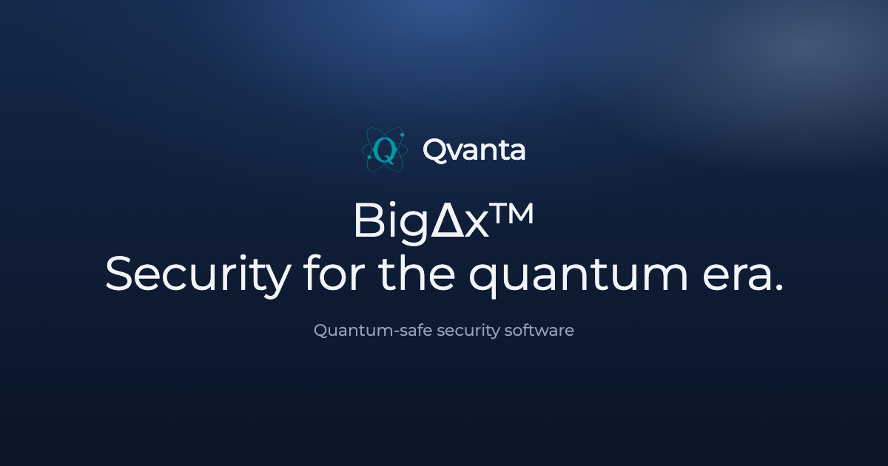

<!--
  Org profile for https://github.com/Qvanta-BigDx-Group
  Brand voice aligned with https://qvanta.io
-->

  

### BigΔx™ by Qvanta®

# Security for the quantum era.

Encryption, malware protection, and secure messaging that stay secure as quantum computers mature.  
Built for businesses, government agencies, and research teams.

 

[Website](https://qvanta.io) · [Products](https://qvanta.io/Products.dc.html) · [Government](https://qvanta.io/Government.dc.html) · [Research](https://qvanta.io/Research.dc.html) · [Contact](https://qvanta.io/Contact.dc.html)

---

## Six products. One quantum-safe stack.

Endpoint, AI, data center, storage, secrets, and messaging — built for the day today's encryption stops being enough.

| Mark | Product | Protects |
| --- | --- | --- |
| **QAV™** | [Quantum Antivirus](https://qvanta.io/Product.dc.html?p=QAV) | Polymorphic and AI-generated malware |
| **QAIFW™** | [Quantum AI Firewall](https://qvanta.io/Product.dc.html?p=QAIFW) | What AI models and agents can see, say, and do |
| **QDC™** | [Quantum Data Center](https://qvanta.io/Product.dc.html?p=QDC) | Post-quantum security for existing data centers |
| **QSV™** | [Quantum Secure Vault](https://qvanta.io/Product.dc.html?p=QSV) | Data at rest and in transit |
| **QPS™** | [Quantum PulseShare](https://qvanta.io/Product.dc.html?p=QPS) | Secrets and files that burn after reading |
| **QWM™** | [Quantum Whisper](https://qvanta.io/Product.dc.html?p=QWM) | Sensitive team messaging |

No rip-and-replace. BigΔx goes in next to what you already run.

---

## Where do you want to start?

| | Path | |
| :---: | --- | --- |
| **01** | **[Businesses](https://qvanta.io/Products.dc.html)** — see the six BigΔx products, what each protects, and where it runs | |
| **02** | **[Government & defense](https://qvanta.io/Government.dc.html)** — public-sector programs and cyber investigations | |
| **03** | **[Researchers](https://qvanta.io/Research.dc.html)** — formal math, crypto research, QVNT on Solana | |
| **04** | **[Talk to a person](https://qvanta.io/Contact.dc.html)** — demo, briefing, partnership, press, or investors | |

---

## This organization

Private engineering home for Qvanta® and BigΔx™ — websites, product platforms, mobile clients, research harnesses, and internal tooling.

Repos here are **private by default**. Public face of the company: **[qvanta.io](https://qvanta.io)**.

  
  

Qvanta® software and services are intended for lawful and authorized use only.

